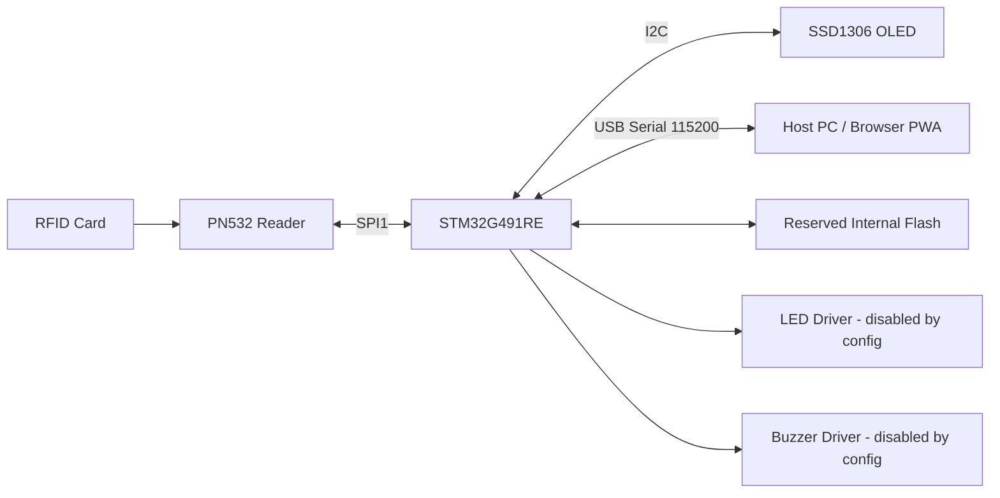
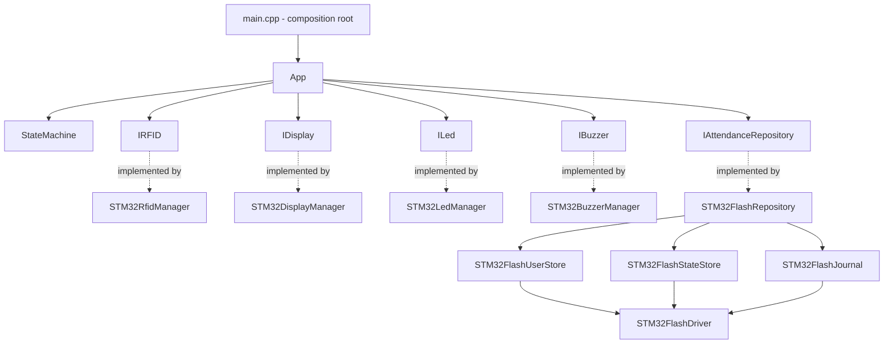
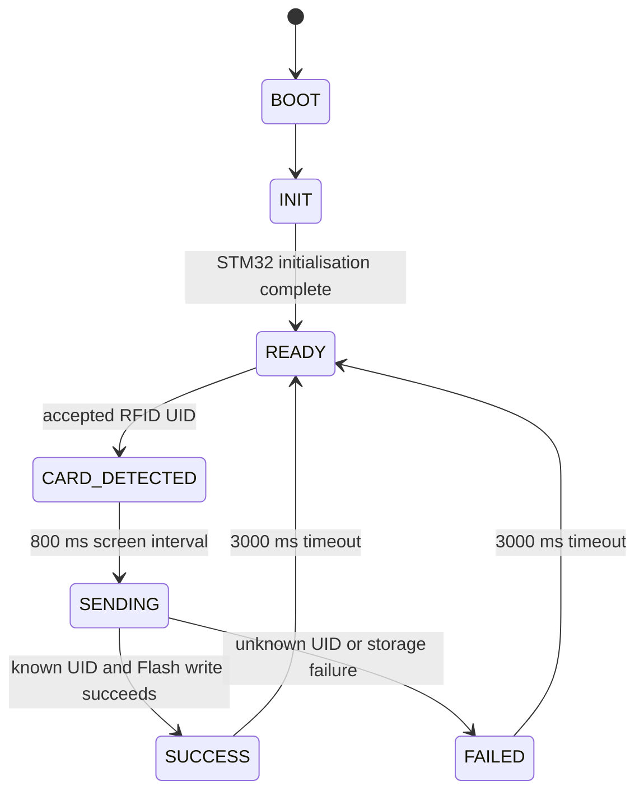
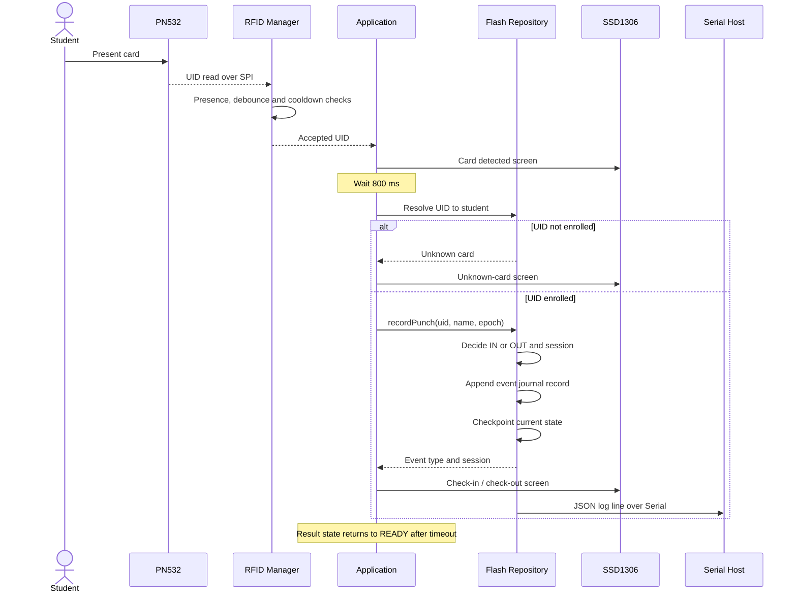

# STM32G491RE RFID Attendance Terminal
## Firmware Architecture, Hardware Integration & Technical Presentation

> **Implementation reference:** `standalone_g491re/` on the repository's `master` branch.  
> **Target:** ST NUCLEO-G491RE / STM32G491RET6  
> **Firmware version reported by source:** `1.0.0`  
> **Build system:** PlatformIO + STM32 Arduino framework + GNU C++17  
> **Storage model:** Three-zone, internal-Flash persistence. No MicroSD card is required by this standalone target.

This document describes the standalone firmware implementation currently present in the source tree. It is not a statement that every optional peripheral is connected or enabled on a physical prototype. Pin definitions, compile-time feature flags, implementation paths, and test scripts are identified separately where that distinction matters.

---

## 1. Project summary

The firmware implements a local RFID attendance terminal on the STM32G491RE. A PN532 reader supplies card UIDs, an SSD1306 OLED presents the device and attendance state, the application resolves enrolled cards against a local student directory, and attendance events are recorded in the MCU's reserved internal Flash region.

The design has three primary responsibilities:

1. **Card acquisition and feedback** — initialise and poll the PN532 over SPI, detect removal/re-presentation, suppress rapid duplicate scans, and render the current workflow on the OLED.
2. **Attendance state and persistence** — resolve a UID to an enrolled student, alternate check-in/check-out events for the active attendance date, preserve the event journal, and reconstruct state after reboot.
3. **Host integration** — expose a serial command interface at 115200 baud for status, user management, time setting, and streaming attendance records to a host application such as the companion PWA.

### What this firmware is not

- It is not the older MicroSD/FAT filesystem implementation.
- The standalone STM32 build does not require Wi-Fi or an HTTP backend for attendance.
- It does not demonstrate that a remote cloud API is operational. The API client contains a standalone local path and mock path; the real cloud submission path returns “Real API not implemented”.
- The configured LED and buzzer managers are currently disabled by compile-time constants. Their driver code exists, but the current configuration does not enable physical output.
- It is not accurate to describe every operation as non-blocking. The main application is state-driven, but boot animation, PN532 initialisation/retry, and the mock API path contain delays.

---

## 2. Target platform and build configuration

The PlatformIO environment is defined in `standalone_g491re/platformio.ini`.

| Item | Current source configuration |
|---|---|
| PlatformIO environment | `standalone_g491re` |
| Platform | `ststm32` |
| Board identifier | `nucleo_g491re` |
| Framework | Arduino |
| Language standard | GNU C++17 |
| Serial monitor | 115200 baud |
| Upload protocol | ST-LINK |
| Library dependency | Adafruit PN532 `^1.3.3` |
| Library dependency | U8g2 `^2.35.7` |
| Library dependency | ArduinoJson `^7.0.4` |
| Linker size symbol | `LD_MAX_SIZE=0x70000` |
| Include directory | `include` |

### Build and flash

Run these commands from the repository root:

```bash
pio run -d standalone_g491re
pio run -d standalone_g491re -t upload
pio device monitor -b 115200
```

The upload configuration selects ST-LINK. The firmware entry point is `standalone_g491re/src/main.cpp`.

### MCU characteristics

The project configuration and comments target the STM32G491RE device family. The board is configured for the STM32G491RE, with a 170 MHz Cortex-M4 core, 512 KB Flash, and 112 KB SRAM as stated in the project configuration. The firmware reserves the top 64 KB of internal Flash for its own data layout; the linker size option is intended to keep the program image below that reserved area.

The source-level storage partition is explicit. Before flashing a modified linker configuration or changing the partition, verify the final linker map and the exact MCU flash geometry against the selected board definition.

---

## 3. Hardware topology

### Main functional blocks



The STM32 application owns the workflow. Peripheral managers implement device-specific behaviour and are passed to the application during initialisation.

### Pin map from `include/pins.h`

| Peripheral | Signal | MCU pin | Board header alias / note |
|---|---|---:|---|
| PN532 | SCK | PA5 | Arduino D13 / SPI1 clock |
| PN532 | MISO | PA6 | Arduino D12 / SPI1 MISO |
| PN532 | MOSI | PA7 | Arduino D11 / SPI1 MOSI |
| PN532 | NSS / CS | PB6 | Arduino D10 / SPI1 chip select |
| PN532 | Reset | PB1 | Defined in source; not required by all module variants |
| SSD1306 OLED | SCL | PA9 | Arduino D8 |
| SSD1306 OLED | SDA | PA8 | Arduino D7 |
| Green LED | GPIO | PA1 | Driver is currently disabled |
| Red LED | GPIO | PA2 | Driver is currently disabled |
| Buzzer | GPIO / tone | PB8 | Driver is currently disabled |
| Legacy SD CS definition | CS | PA4 | Defined in pin header, but no SD implementation is used by this standalone target |

**Important wiring distinction:** The source defines PA5/PA6/PA7 as the PN532 SPI1 bus and PB6 as its chip-select signal. The OLED uses PA9/PA8 in the current pin header. Do not use pinouts copied from the previous firmware guide; those describe a different implementation.

The source README lists PN532 VCC as 5 V or 3.3 V. Confirm the exact breakout board's regulator and logic-level specifications before wiring it. Common ground is required. Do not assume every PN532 board tolerates 5 V logic merely because its power input accepts 5 V.

### PN532 mode

The RFID manager constructs the Adafruit PN532 instance with the configured chip-select pin and the hardware `SPI` object. The initialisation sequence wakes the reader, starts the library, retries firmware-version detection up to three times, configures SAM mode, and configures passive activation retries. The source assumes the PN532 is switched to hardware SPI mode.

The standalone README documents the PN532 SW1 positions as:
- Switch 1 (`I0`): OFF
- Switch 2 (`I1`): ON

The reader samples its interface selection at power-on. After changing the DIP switch, fully remove module power before testing again. Validate the exact switch legend on the module revision in use.

---

## 4. Firmware structure

The standalone target is intentionally self-contained. Its source is organised around the application workflow, peripheral managers, and the Flash persistence implementation.

| File / group | Responsibility |
|---|---|
| `src/main.cpp` | Global object composition, Arduino `setup()` and `loop()`, serial command dispatch |
| `src/app.cpp`, `include/app.h` | Application orchestration and state handlers |
| `src/state_machine.cpp`, `include/state_machine.h` | State transitions, transition validation, elapsed-state timing |
| `src/rfid_manager.cpp`, `include/rfid_manager.h` | PN532 SPI initialisation, polling, card-presence logic, duplicate suppression, simulated input |
| `src/display_manager.cpp`, `include/display_manager.h` | SSD1306 rendering through U8g2 |
| `src/cli_manager.cpp`, `include/cli_manager.h` | Serial command parser and JSON responses |
| `src/STM32FlashDriver.cpp` | STM32 HAL Flash erase, program, and read primitives |
| `src/STM32FlashUserStore.cpp` | Enrolled-user A/B bank store |
| `src/STM32FlashStateStore.cpp` | Current-day IN/OUT state and compaction |
| `src/STM32FlashJournal.cpp` | Append-only attendance event journal |
| `src/STM32FlashRepository.cpp` | Repository facade, attendance transitions, timekeeping, reboot reconciliation |
| `src/led_manager.cpp`, `src/buzzer_manager.cpp` | Optional feedback drivers |
| `include/*.h` | Interfaces, configuration, constants, shared types, pin map, storage structures |

### Layering and dependency boundaries

The application receives pointers to display, RFID, LED, buzzer, and attendance repository interfaces. The concrete implementations are constructed in `main.cpp`.



This is an interface-oriented architecture with dependency injection at the application boundary. It reduces the amount of hardware-specific code in the state handlers. It does **not** prove that the whole project can be moved to another MCU without changes: the concrete Flash driver, Arduino core, peripheral libraries, linker layout, and pin definitions are STM32-specific.

---

## 5. Boot sequence and runtime lifecycle

### Composition root

`main.cpp` creates one instance of each concrete manager and the Flash repository:

- `STM32DisplayManager`
- `STM32RfidManager`
- `STM32LedManager`
- `STM32BuzzerManager`
- `STM32FlashRepository`
- `App`
- `CliManager`

In `setup()`, serial is opened at 115200 baud, the application is initialised, and the CLI is attached to the repository and RFID manager.

In `loop()`, the CLI is polled first. Unrecognised serial input is passed to the RFID manager as simulated card input; then `app.update()` advances the application.

### Initialisation order

1. Start the serial interface.
2. Initialise the application state machine.
3. Initialise the OLED and show the boot progress animation.
4. Initialise LED and buzzer manager objects (their output is disabled by current constants).
5. Initialise the RFID reader.
6. Initialise the three Flash storage zones.
7. Initialise the API client in standalone mode.
8. Move the STM32 build into `READY` without attempting Wi-Fi.

The boot animation contains explicit delays. The PN532 setup also uses short delays and a retry sequence. These are startup operations; they should not be represented as a fully non-blocking boot.

### Application state machine

The state enum in `include/types.h` contains:

- `BOOT`
- `INIT`
- `WIFI_CONNECTING`
- `BACKEND_CONNECTING`
- `READY`
- `CARD_DETECTED`
- `SENDING`
- `SUCCESS`
- `FAILED`
- `NETWORK_ERROR`

For the STM32 compile target, conditional Wi-Fi sections are excluded, so the active path is effectively:



The general state machine still defines network-related states because the codebase contains conditional ESP32 paths. Those states are not part of the normal STM32-only runtime sequence.

The display result timeout is defined as 3000 ms. The card-detected screen is held for at least 800 ms before submission.

---

## 6. RFID acquisition and duplicate prevention

The PN532 driver uses hardware SPI and polls at the interval set by `RFID_POLL_INTERVAL_MS` (200 ms).

The implementation applies several checks:

1. **Reader readiness:** initialise the PN532 and query its firmware version, retrying up to three times.
2. **Card already present:** the same UID continuously in the RF field is not repeatedly emitted as a new tap.
3. **Removal confirmation:** two consecutive no-card polling cycles are required before the reader considers the previous card removed.
4. **Global scan debounce:** accepted card events are separated by the configured 2000 ms debounce.
5. **Per-UID cooldown:** the same UID is suppressed for 5000 ms after an accepted scan. The in-memory cooldown table holds up to eight UIDs and then replaces slot zero.
6. **Boot-time field check:** if a card is already on the antenna when the reader initialises, it is latched as present and must be removed before it can generate a new event.

The 2-second debounce and 5-second same-UID cooldown are separate controls. The physical removal check also prevents a card held continuously on the antenna from alternating between check-in and check-out.

### Reader fallback and simulation

If PN532 firmware detection fails after retries, the RFID manager sets itself to simulated mode and reports itself ready. The periodic recovery path retries PN532 detection every five seconds. If the reader becomes available, it restores normal hardware mode.

Separately, the main loop forwards unrecognised serial lines to `processSimulatedInput()`. A sufficiently long line is treated as a simulated UID, subject to the same per-UID cooldown.

This is a diagnostic/testing convenience. A simulated UID received over serial is **not** evidence that the physical RFID reader has read a card.

---

## 7. Attendance rules and event lifecycle

### UID resolution

When an accepted UID reaches the application, the standalone API client looks up the UID in the Flash-backed student directory:

- UID found: proceed to attendance recording.
- UID not found: return `UNKNOWN_CARD` and display the corresponding failure screen.
- Journal full or event append fails: return a storage/backend error and do not report a successful attendance event.

### Check-in / check-out model

The repository keeps a current-day state for each observed student:

- If the student's current state is CHECKED OUT, the next accepted punch is **Check-in** and increments the session number.
- If the student's current state is CHECKED IN, the next accepted punch is **Check-out** and uses the same session number as the matching check-in.
- On date rollover, the current-day IN/OUT cache is reset for the new date. The historical journal remains available.

This allows multiple sessions per student per date, represented as paired IN and OUT punches.

### Sequence of an accepted physical card



The JSON live log is emitted from the standalone attendance path after a successful repository write. The command-driven `DUMP_LOGS` path separately streams stored events on request.

---

## 8. Internal Flash persistence design

The standalone implementation uses a 64 KB region at the top of the STM32G491RE Flash address space.

### Physical partition

| Region | Flash pages | Address range | Size | Purpose |
|---|---:|---|---:|---|
| Zone A — User directory | 224–231 | `0x08070000–0x08073FFF` | 16 KB | Two 8 KB user banks |
| Zone B — Active state | 232–235 | `0x08074000–0x08075FFF` | 8 KB | Two 4 KB state banks |
| Zone C — Event journal | 236–255 | `0x08076000–0x0807FFFF` | 40 KB | Append-only attendance records |
| **Total reserved** | **224–255** | `0x08070000–0x0807FFFF` | **64 KB** | Persistent data |

The storage header defines a Flash page size of 2048 bytes. The low-level Flash driver limits page erases and writes to this reserved address range.

### Zone A — Enrolled users

- Two 8 KB banks, A and B.
- Each user record occupies 64 bytes and contains UID, name, role, flags, and a CRC16 field.
- A bank header stores a magic value, sequence number, user count, and CRC32.
- Updating the user list writes a new image to the inactive bank, then updates the active-bank pointer after the new header has been written.
- On boot, the store validates bank headers and their record-area CRC32 values, then selects the valid bank with the greater sequence number.

**Capacity note:** The raw layout formula yields 127 record slots, while the source comments describe a 126-user cap. The validation code also rejects bank headers with a count greater than 120. Therefore this document does not claim 126/127 users as a verified operational capacity; the effective cap and enforcement should be reconciled in code before relying on a maximum figure.

**Implementation caveat:** The user-store update loops do not check every individual record-copy/program return value, and the delete path erases the inactive bank before checking whether the requested UID exists. The A/B design is intended to preserve the active copy during updates, but the implementation should not be described as unconditionally power-fail-safe until these write-result and failure paths are hardened and tested.

### Zone B — Active attendance state

- Two 4 KB banks, each spanning two 2 KB Flash pages.
- Stores compact transition records with UID, state, session, event ID, timestamp/date, flags, and CRC16.
- Maintains an in-memory cache for quick current-day state lookup.
- The active bank is selected using a generation counter and validated header CRC.
- When the bank fills, compaction writes a snapshot of currently checked-in students to the other bank, then erases the previous bank.
- State from a previous calendar date is treated as checked out for the new date.

The state-store header is not the attendance history. It exists to answer the question “is this student currently checked in today, and which session is active?”

### Zone C — Attendance event journal

- 40 KB across pages 236–255.
- 16-byte journal header.
- 48-byte packed event records.
- Append-only writes; old event records are not overwritten during normal logging.
- Each record contains a marker, event type, session ID, event ID, 64-bit epoch timestamp, UID, attendance date, flags, short name cache, and CRC16.
- On boot, the journal scans slots, counts records with a committed marker and valid CRC16, and restores the next-write location and highest event ID.
- When the journal is full, further punches are rejected rather than overwriting previous records.

The current capacity expression is:

```text
(40,960 bytes - 16-byte header) / 48-byte record = 853 records
```

So the configured journal holds **853 records**, not the 1,024 figure present in the old presentation document and earlier standalone README.

### Two-phase attendance persistence and reboot reconciliation

For a punch, the repository performs these steps:

1. Determine whether the next event is IN or OUT from Zone B.
2. Append the historical event to Zone C and assign an event ID.
3. Checkpoint the new current state to Zone B.
4. If Zone B checkpointing fails after the Zone C append succeeds, the repository still returns success because the event record is persisted.
5. During boot, compare the highest event IDs in Zones B and C. If the journal is ahead, replay later journal events into the state store to reconstruct the active state.

This separation is important: Zone C is the historical record; Zone B is the compact current-state index used to decide the next IN/OUT event.

### What `CLEAR_LOGS` actually clears

`CLEAR_LOGS` erases **Zone C only** (pages 236–255), recreates the journal header, and resets the journal counters/write pointer. It does not erase Zone A users or Zone B active state.

Consequently:
- Enrolled users remain enrolled.
- The current IN/OUT state and session information remain in Zone B.
- The historical log exported by `DUMP_LOGS` is removed.
- The next punch continues from the preserved active state, even though previous event history has been cleared.

This is intentional in the repository implementation and should be considered before running the command on real attendance data.

### Flash endurance and lifecycle considerations

Internal Flash is not an unlimited database. Zone A rewrites a bank during user changes; Zone B uses append-and-compact behaviour; Zone C appends until full and then requires log export/clear. The code does not provide a wear-levelled filesystem. Production deployment should include endurance budgeting, backup/export procedures, power-loss testing at each commit phase, and a defined recovery process for corrupted or exhausted regions.

---

## 9. Timekeeping

The STM32 firmware does not obtain time from an onboard Wi-Fi/NTP path in this standalone build. The host can set time over serial using `SET_TIME` or `SYNC_TIME`.

Command format:

```text
SET_TIME <unix_epoch_seconds> <timezone_offset_minutes>
```

Example for India Standard Time (UTC+05:30):

```text
SET_TIME 1793385600 330
```

The CLI accepts epoch values later than 2020-01-01. The repository stores the supplied base epoch and the current `millis()` value, then advances the epoch using elapsed uptime seconds. It derives the attendance date after applying the supplied timezone offset.

**Time persistence limitation:** The base epoch and sync uptime are held in RAM. The source shown does not persist the clock calibration in Flash or provide a battery-backed RTC implementation. After a power cycle, the host should synchronise time again. If the clock has not been synchronised, records are marked with the unsynchronised flag and timestamps are based on uptime rather than real Unix time.

The configured timezone defaults in `config.h` are not a substitute for issuing the serial time-sync command to the Flash repository.

---

## 10. Serial protocol and host PWA integration

The serial CLI runs at 115200 baud. Commands are line-oriented; responses include structured JSON for machine-consumed data and `{"type":"done"}` as the end-of-command marker.

### Command reference

| Command | Purpose | Response behaviour |
|---|---|---|
| `HELP` | Print command help | Text help + done marker |
| `STATUS` | Report board, firmware, storage, RFID state, user/log counts, clock state | JSON `type=status` + done |
| `ADD_USER <json>` | Add an enrolled user | JSON `type=user` on success; error JSON on failure; done |
| `DELETE_USER <uid>` | Remove a user | JSON `type=deleted` on success; error JSON on failure; done |
| `DUMP_USERS` | Stream enrolled UID/name mapping | Begin marker, JSON object, end marker, done |
| `DUMP_LOGS` | Stream historical attendance rows | Begin marker, one JSON record per line, end marker, done |
| `CLEAR_LOGS` | Erase journal history only | Success/error text + done |
| `SET_TIME <epoch> <tz-minutes>` | Set host-provided clock base and timezone offset | JSON `type=time_sync` + done |
| `SYNC_TIME <epoch> <tz-minutes>` | Alias for SET_TIME | Same as SET_TIME |

### User creation payload

```json
{
  "uid": "04A1B2C3",
  "name": "Alice Johnson",
  "role": "Student"
}
```

The CLI validates that:
- UID length is between 4 and 32 characters.
- UID contains hexadecimal characters only.
- Name is not empty and is no longer than 80 characters.
- The UID is not already present.

The Flash record stores a bounded UID/name/role representation. The user record fields are smaller than the CLI's accepted input maximums; validate maximum UID and name lengths against the storage record sizes before using long values.

### Status payload shape

The status response includes:
- `board`
- `firmware`
- `storage`
- `rfid`
- `users`
- `logs`
- `time_synced`
- `time`

For the standalone target, storage reports `FLASH`. RFID reports `ONLINE`, `SIMULATED`, or `OFFLINE` based on the driver state. User and log counts are computed from the repository.

### Attendance log payload shape

A streamed attendance record contains fields such as:

```json
{
  "uid": "04A1B2C3",
  "name": "Alice Johnson",
  "timestamp": 1793385600,
  "event": "Check-in",
  "status": "IN",
  "session": 1,
  "event_id": 1,
  "date": 20261130
}
```

The example values are illustrative, not live device output. The repository serialises one record per JSON line for `DUMP_LOGS`, and the standalone attendance submission path emits a `{"type":"log","data":{...}}` message after a successful write for live host updates.

### PWA relationship

The firmware communicates with the browser application over the serial transport. The browser does not need to query a cloud API for this local firmware path. The PWA can request status, users, and logs; send user-management and time-sync commands; and receive live attendance JSON events.

The firmware CLI and PWA must agree on baud rate, command spelling, response framing, and JSON fields. When changing either side, validate the complete request/response flow rather than relying on an isolated parser test.

---

## 11. Fault handling and current feature flags

| Condition | Current behaviour in source |
|---|---|
| PN532 not detected at boot | After three attempts, driver enters simulated mode and reports ready |
| PN532 later becomes available | RFID manager retries detection every five seconds |
| Same physical card remains on antenna | No new event until removal is detected |
| Same UID scanned within cooldown | Scan is suppressed |
| Unknown UID | Failure/unknown-card display state |
| Attendance journal full | New attendance write is rejected; old journal records are not overwritten |
| Clock not synced | Event receives unsynchronised flag; timestamp is uptime-derived |
| Zone B checkpoint fails after journal append | Event remains persisted in Zone C; boot reconciliation is intended to restore state |
| LED manager | Disabled by `LEDS_ENABLED=false` |
| Buzzer manager | Disabled by `BUZZER_ENABLED=false` |
| Wi-Fi on STM32 target | Compile-time ESP32-only sections are excluded |

### Configuration values of note

From `include/constants.h`:
- Serial baud: 115200
- RFID poll interval: 200 ms
- Global RFID debounce: 2000 ms
- Same-UID cooldown: 5000 ms (enforced in RFID manager)
- Card-detected display interval: 800 ms (application handler)
- Result screen timeout: 3000 ms
- LEDs enabled: false
- Buzzer enabled: false

From `include/config.h`:
- Debug mode: true
- Standalone mode: true
- Show UID on detect: true

The Wi-Fi credentials, server URL, API version, and device ID in `config.h` are legacy/shared configuration declarations. They do not mean the STM32 standalone runtime uses Wi-Fi or a remote backend.

---

## 12. Testing and verification assets

The `standalone_g491re/test/` directory contains serial-driven Python scripts:

| Script | Intended coverage |
|---|---|
| `test_serial.py` | Serial connection, add-user command, dump-users, status |
| `test_punch.py` | Simulated UID input, attendance event output, dump-logs, status |
| `test_verification.py` | User management, punch, reboot/reconnect persistence, delete, clear logs |
| `test_reboot.py` | Check-in, serial reconnect/reset, state persistence, subsequent check-out |
| `test_in_out.py` | Repeated IN/OUT sessions, cooldown, journal dumping, clear-log/state preservation |
| `test_add.py` | User-add flow |

These are hardware/serial integration scripts, not a host-independent unit-test suite. Several scripts hard-code `COM14`; change the port to the actual serial device before running. Some scripts intentionally mutate device state by adding/deleting users or clearing logs. Use test cards and a non-production device/data set.

A meaningful validation pass should cover:
1. Compile the exact `standalone_g491re` PlatformIO environment.
2. Flash the NUCLEO-G491RE and capture boot output.
3. Confirm `STATUS` reports `storage=FLASH` and the expected PN532 mode.
4. Add a test UID, read it back, reboot, and read it back again.
5. Scan an enrolled card twice with the cooldown respected; verify IN then OUT session behaviour.
6. Reboot between IN and OUT and verify the state is reconstructed.
7. Fill or simulate journal exhaustion in a controlled test and verify no old event is overwritten.
8. Run `CLEAR_LOGS`, verify Zone C is empty, and verify Zone B state remains intact.
9. Set time from the host and verify timestamp/date output; reboot and confirm the host synchronises time again.

**Test evidence status for this document:** the source contains these test scripts, but this document-generation review did not execute them against a connected STM32 board. No hardware pass rate or timing benchmark is claimed here.

---

## 13. Known implementation caveats to address before production

The following points are visible from the current source and should be handled before describing the firmware as production-grade:

1. **User-store capacity inconsistency:** storage comments/formula, source validation threshold, and README capacity descriptions do not agree. Define and enforce one maximum across CLI, storage, and documentation.
2. **Flash operation error propagation:** user-bank copy/write loops and parts of state compaction do not check every Flash write result. A successful top-level operation should require all necessary writes and verification to succeed.
3. **Delete operation ordering:** `deleteUser()` erases the inactive bank before it checks whether the UID exists. This is unnecessary Flash wear for a missing UID and should be reordered.
4. **Flash write bounds:** `writeBuffer()` checks each programmed double-word against the reserved partition, but does not first validate the entire requested range or the source pointer alignment. Validate the complete request before unlocking/programming Flash.
5. **Power-loss guarantees:** A/B bank selection is a useful recovery pattern, but do not claim “100% immune to corruption”. Prove the write ordering and failure handling with fault-injection/power-cut tests.
6. **State-bank compaction writes:** the compaction path writes the new snapshot/header and erases the old bank without checking every operation result. Verify the standby bank before erasing the previous active bank.
7. **Clock after reset:** current clock base is volatile; time must be re-synchronised by the host after power loss/reset.
8. **Journal full UX:** firmware logs the full condition over serial and reports an error result. Ensure the OLED presentation clearly explains the storage-full condition for an operator.
9. **Simulated fallback visibility:** simulated RFID mode is intentionally available for diagnostics, but should be unmistakable in the UI/status and disabled or protected in an operational deployment.
10. **Disabled indicators:** LED and buzzer drivers are present but compile-time disabled. Do not claim audible or LED feedback is currently active on hardware.
11. **Debug/production configuration:** debug mode is true. Review serial diagnostics, simulation entry points, input validation, and provisioning before a real deployment.
12. **Name and UID field bounds:** the CLI accepts values longer than the fixed-width Flash fields. Enforce limits that match the actual record layout to avoid silent truncation.

These are source-review observations, not proof that data has already been lost or that a specific runtime failure has occurred.

---

## 14. Presentation outline

A concise technical presentation can follow this order:

1. **Problem and objective** — local RFID-based attendance with no required network dependency.
2. **Hardware** — NUCLEO-G491RE, PN532 on SPI1, SSD1306 on I2C, USB serial to host.
3. **Application architecture** — interfaces, managers, state machine, repository composition.
4. **Attendance flow** — card read, duplicate suppression, UID lookup, IN/OUT decision, journal commit, OLED response.
5. **Flash storage** — three zones, A/B user banks, compact current-state store, append-only event journal.
6. **Host integration** — 115200-baud command protocol, JSON status/users/logs, browser PWA.
7. **Recovery and limits** — reboot reconciliation, time resync, full journal handling, current disabled hardware outputs, and engineering work still required.

### Suggested 60-second explanation

> “This project is a standalone RFID attendance terminal built for the STM32G491RE. The PN532 reads student cards over SPI, and the application checks the card against a locally stored student directory. Each valid tap alternates the student's attendance state between check-in and check-out for the current date. The system stores the historical event journal and the current attendance state separately in reserved internal Flash, so the active IN/OUT state can be reconstructed after a restart. A serial command interface at 115200 baud connects the device to a browser-based host application for status, user management, time synchronisation, and attendance export. The current implementation is intentionally offline-capable and does not require a cloud service for its STM32 attendance path.”

---

## 15. Source-of-truth map

The implementation details in this document are based primarily on these files:

- [Standalone firmware README](standalone_g491re/README.md)
- [PlatformIO environment](standalone_g491re/platformio.ini)
- [Firmware entry point](standalone_g491re/src/main.cpp)
- [Application orchestrator](standalone_g491re/src/app.cpp)
- [State machine](standalone_g491re/src/state_machine.cpp)
- [RFID manager](standalone_g491re/src/rfid_manager.cpp)
- [Pin definitions](standalone_g491re/include/pins.h)
- [Timing and feature constants](standalone_g491re/include/constants.h)
- [Storage layout and record structures](standalone_g491re/include/flash_storage.h)
- [Flash driver](standalone_g491re/src/STM32FlashDriver.cpp)
- [Flash repository](standalone_g491re/src/STM32FlashRepository.cpp)
- [User bank store](standalone_g491re/src/STM32FlashUserStore.cpp)
- [Active-state store](standalone_g491re/src/STM32FlashStateStore.cpp)
- [Attendance journal](standalone_g491re/src/STM32FlashJournal.cpp)
- [Serial CLI](standalone_g491re/src/cli_manager.cpp)
- [API/local attendance path](standalone_g491re/src/api_client.cpp)
- [Hardware integration scripts](standalone_g491re/test/)

For future updates, revise this document from `standalone_g491re/` source first. Do not use the legacy `hardware/firmware/` implementation or an earlier presentation document as the authority for this target.
