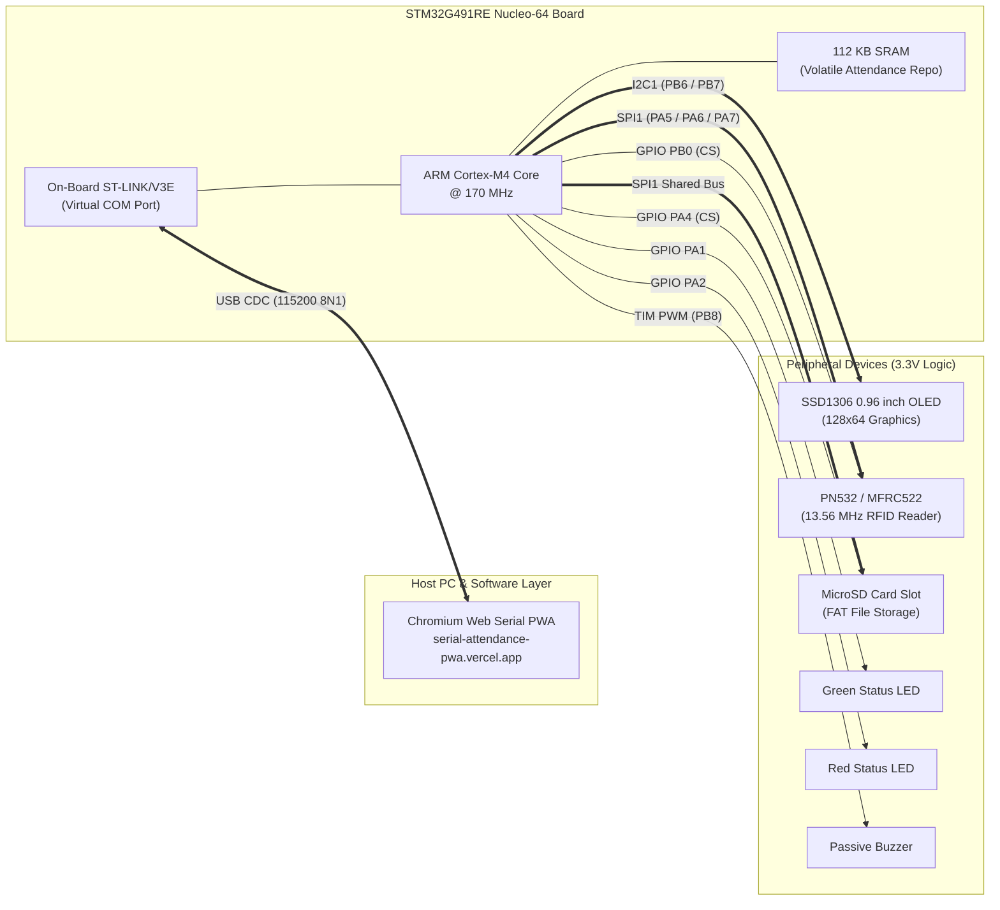
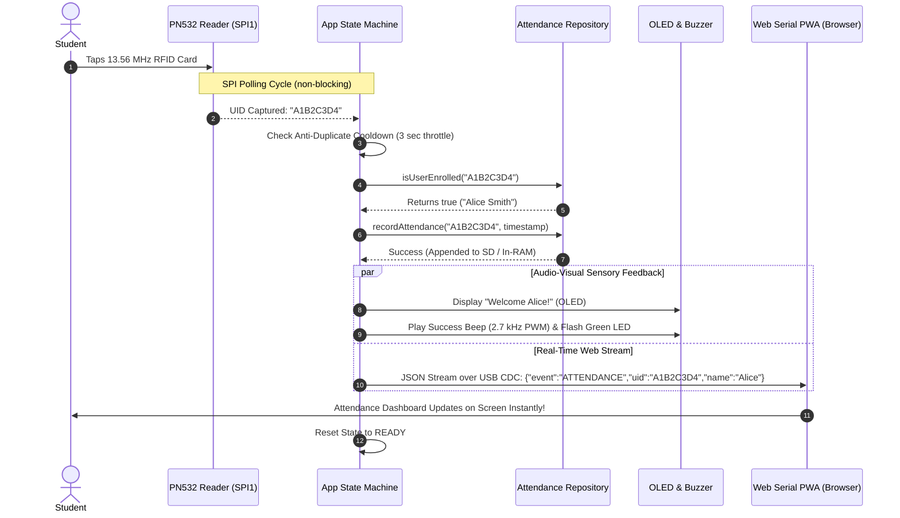
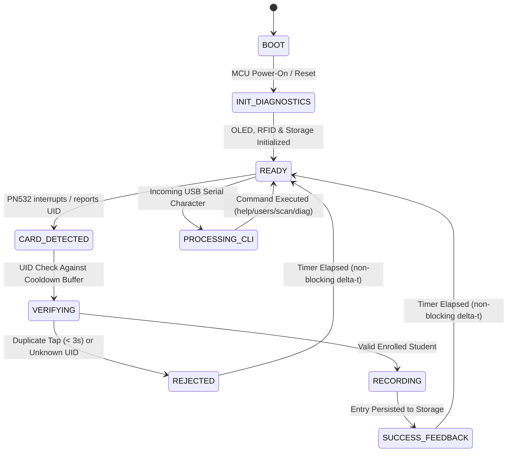
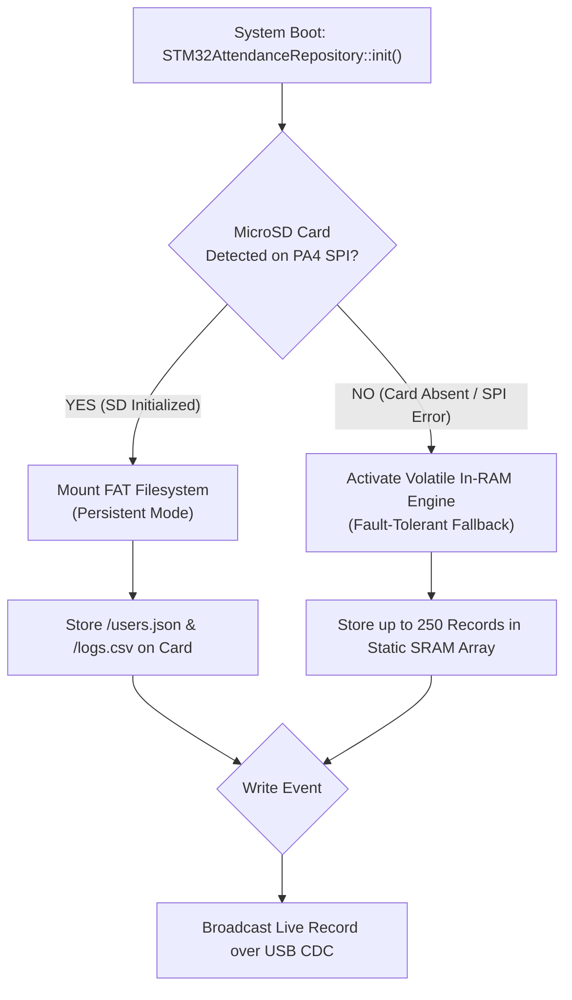

# 🎓 STM32G491RE IoT RFID Attendance Terminal — Student Presentation & Viva Defense Guide

> **Target Audience:** Undergraduate Computer Science & Engineering (UG CSE / ECE) students, evaluators, lab instructors, and project defense panels.  
> **Target Microcontroller:** **STMicroelectronics Nucleo-64 (STM32G491RE)** running modern C++17 firmware.  
> **Live Testing PWA:** [serial-attendance-pwa.vercel.app](https://serial-attendance-pwa.vercel.app/)

---

## 📑 Presentation Table of Contents

1. [🎙️ The 60-Second Elevator Pitch (Opening Statement)](#1-the-60-second-elevator-pitch-opening-statement)
2. [🔌 System Hardware Topology & 5-Minute Breadboard Pinout](#2-system-hardware-topology--5-minute-breadboard-pinout)
3. [🏗️ Software Architecture: Clean C++17 & Dependency Injection](#3-software-architecture-clean-c17--dependency-injection)
4. [🔄 The Life of an Attendance Tap (End-to-End Sequence)](#4-the-life-of-an-attendance-tap-end-to-end-sequence)
5. [⚙️ Non-Blocking Finite State Machine (FSM)](#5-non-blocking-finite-state-machine-fsm)
6. [🛡️ Dual-Storage Engine & Hardware Fault-Tolerance](#6-dual-storage-engine--hardware-fault-tolerance)
7. [🌐 Direct Browser Sync: Chromium Web Serial Architecture](#7-direct-browser-sync-chromium-web-serial-architecture)
8. [🎯 Teacher Viva Defense Sheet (Top 10 Exam Questions & Answers)](#8-teacher-viva-defense-sheet-top-10-exam-questions--answers)

---

## 1. 🎙️ The 60-Second Elevator Pitch (Opening Statement)

> *"Good morning, respected professors and evaluators. Today I am presenting our **IoT RFID Attendance Terminal** implemented on the **STM32G491RE** microcontroller.*  
>
> *Traditional attendance systems suffer from two extremes: they are either rudimentary, fragile Arduino prototypes built with blocking code, or overly complex commercial kiosks requiring high-maintenance cloud subscriptions and dedicated local database servers.*  
>
> *Our engineering objective was to build an **educational foundation and base architecture** demonstrating enterprise-grade embedded engineering:  
> 1. **Modern C++17 & Dependency Injection (DI):** Core business logic is completely isolated from physical STM32 registers via pure abstract interfaces.  
> 2. **Non-Blocking State Machine:** Operates with $0\text{ ms}$ busy-waiting delays, ensuring sub-millisecond responsiveness for card detection, audio feedback, and graphics.  
> 3. **Dual-Persistence Engine:** Automatically uses high-capacity MicroSD SPI storage, but gracefully falls back to an internal volatile In-RAM database if no card module is present.  
> 4. **Cloudless Web Serial Sync:** Streams attendance logs directly to a modern Chromium PWA at **115200 baud** via native USB CDC—completely free of cloud dependencies, Wi-Fi credential failures, or server hosting costs.*  
>
> *Let us examine the hardware topology and software design under the hood."*

---

## 2. 🔌 System Hardware Topology & 5-Minute Breadboard Pinout

The **STM32G491RE** is a 32-bit ARM Cortex-M4 MCU equipped with a hardware Floating Point Unit (FPU), running at **170 MHz** with **512 KB Flash** and **112 KB SRAM**.

### 2.1 Hardware Interconnect Topology



---

### 2.2 5-Minute Breadboard Wiring Cheat-Sheet

All peripheral logic runs strictly at **3.3V**. The Nucleo-64 board provides standard **Morpho headers** (wide male headers) and inner **Arduino Uno V3 compatible female headers**.

| Peripheral Module | Signal / Function | Nucleo Pin | Arduino Header | Wire Color Recommendation | Notes |
| :--- | :--- | :--- | :--- | :--- | :--- |
| **SSD1306 OLED (0.96")** | `SCL` (I²C Clock) | `PB6` | `D10` | Yellow | 4.7kΩ pull-up to 3.3V included on breakout |
| | `SDA` (I²C Data) | `PB7` | `D4` | Blue | Hardware I2C1 bus |
| | `VCC` | `3V3` | `3.3V` | Red | Strict 3.3V logic (Do NOT use 5V!) |
| | `GND` | `GND` | `GND` | Black | Common ground plane |
| **PN532 RFID Reader** | `SCK` (SPI Clock) | `PA5` | `D13` | Orange | Shared SPI1 bus |
| | `MISO` (Master In) | `PA6` | `D12` | Yellow | Shared SPI1 bus |
| | `MOSI` (Master Out) | `PA7` | `D11` | Green | Shared SPI1 bus |
| | `SS` / `CS` (Chip Select) | `PB0` | `A3` | White | Dedicated RFID chip select |
| | `RST` (Hardware Reset) | `PB1` | `A4` | Gray | Active-low reset line |
| **MicroSD SPI Module** | `SCK / MISO / MOSI` | `PA5/PA6/PA7`| `D13/D12/D11` | Shared | Shares SPI1 bus with RFID reader |
| | `CS` (Card Select) | `PA4` | `A2` | Purple | Dedicated SD chip select |
| **Status Indicators** | Green LED (Success) | `PA1` | Morpho Left | Green | 220Ω series resistor to GND |
| | Red LED (Reject/Error) | `PA2` | Morpho Left | Red | 220Ω series resistor to GND |
| | Buzzer (Tone PWM) | `PB8` | `D15` | Blue | Driven via hardware timer PWM |

> [!IMPORTANT]
> **SPI Bus Sharing Rule:**  
> The PN532 RFID Reader and MicroSD module share the exact same `SCK` (`PA5`), `MISO` (`PA6`), and `MOSI` (`PA7`) physical lines. However, **they MUST have separate Chip Select (`CS`) pins**: `PB0` for RFID and `PA4` for SD. The firmware asserts only one `CS` line active-low at any given instant.

---

## 3. 🏗️ Software Architecture: Clean C++17 & Dependency Injection

Most student projects intermingle hardware pin control (`digitalWrite`, `spi.transfer`) directly inside the main application loop. This creates tight coupling ("spaghetti code") where changing an MCU or swapping a display breaks the whole application.

### 3.1 The 3-Tier SOLID Architectural Model

Our firmware applies strict **Dependency Injection (DI)** based on pure C++ abstract interfaces (`lib/platform/interfaces/`):

```mermaid
flowchart TD
    subgraph AppLayer["Tier 1: Application Business Rules (Hardware-Agnostic)"]
        App["App Controller (app.cpp)"]
        State["FSM State Engine"]
        CLI["CLI Command Parser (cli_manager.cpp)"]
    end

    subgraph InterfaceLayer["Tier 2: Pure Abstract Interfaces (C++17 Contracts)"]
        IDisp["«interface»<br/>IDisplay"]
        IRfid["«interface»<br/>IRfid"]
        IBuzz["«interface»<br/>IBuzzer"]
        ILed["«interface»<br/>ILed"]
        IRepo["«interface»<br/>IAttendanceRepository"]
        IPlat["«interface»<br/>IPlatform"]
    end

    subgraph DriverLayer["Tier 3: Hardware Implementation (STM32 Silicon Drivers)"]
        D_Disp["STM32DisplayManager<br/>(SSD1306 via U8g2 / I2C1)"]
        D_Rfid["STM32RfidManager<br/>(PN532 SPI1 / Polling)"]
        D_Buzz["STM32BuzzerManager<br/>(TIM PWM Tone Generator)"]
        D_Led["STM32LedManager<br/>(PA1/PA2 GPIO Push-Pull)"]
        D_Repo["STM32AttendanceRepository<br/>(MicroSD FAT + In-RAM Fallback)"]
        D_Plat["STM32Platform<br/>(Hardware Clock, Heap & Reset)"]
    end

    App --> IDisp
    App --> IRfid
    App --> IBuzz
    App --> ILed
    App --> IRepo
    App --> IPlat

    D_Disp -.->|implements| IDisp
    D_Rfid -.->|implements| IRfid
    D_Buzz -.->|implements| IBuzz
    D_Led -.->|implements| ILed
    D_Repo -.->|implements| IRepo
    D_Plat -.->|implements| IPlat
```



### 3.2 CSE Evaluator Explanation:
* **Inversion of Control (IoC):** The core class `App` does not create instances of hardware drivers. Instead, concrete driver pointers are passed into `App` during boot (`main.cpp`):
  ```cpp
  App app(displayManager, rfidManager, buzzerManager, ledManager, repository, platform);
  ```
* **Portability Proof:** If tomorrow we swap the STM32 for an ESP32 or a Raspberry Pi Pico, **0 lines of application business logic change**. Only Tier 3 driver adapters are substituted.

---

## 4. 🔄 The Life of an Attendance Tap (End-to-End Sequence)

When a student approaches the terminal and taps their RFID card, this synchronous-yet-non-blocking event unfolds in **under 25 milliseconds**:



---

## 5. ⚙️ Non-Blocking Finite State Machine (FSM)

A rookie embedded mistake is using `delay(1000)` to hold a welcome screen or play a buzzer tone. In an attendance kiosk, `delay()` causes **fatal event starvation**: the terminal becomes deaf to new card taps, drops incoming USB packets, and stutters the display.

Our firmware uses an asynchronous **Delta-Time Event Loop**:



### Key FSM States Explained:
* **`READY`:** Idle monitoring loop. Checks PN532 hardware buffer every $10\text{ ms}$ and checks USB CDC RX buffer for incoming CLI instructions.
* **`VERIFYING`:** Compares the UID against the last scanned card. If the identical card is presented within $3\text{ seconds}$, it is rejected as an accidental bounce/double-tap.
* **`SUCCESS_FEEDBACK`:** Starts a non-blocking hardware timer (`FEEDBACK_DURATION = 1500ms`). Green LED is asserted HIGH, buzzer triggers a two-tone ascending frequency chirp, and OLED displays student name. The state machine continues looping without freezing CPU interrupts.

---

## 6. 🛡️ Dual-Storage Engine & Hardware Fault-Tolerance

One of the standout features to showcase to an examiner is the **Zero-Failure Storage Architecture**.



### Why this impresses evaluators:
1. **Academic Graceful Degradation:** If a loose wire disconnects the SD card module during a live presentation, the terminal **does not crash or freeze**. It displays `STORAGE: IN-RAM MODE` on the OLED and functions seamlessly.
2. **Deterministic Memory Footprint:** The In-RAM fallback uses a pre-allocated fixed-size circular buffer. It avoids `malloc()` / `free()`, preventing SRAM heap fragmentation on the ARM Cortex-M4.

---

## 7. 🌐 Direct Browser Sync: Chromium Web Serial Architecture

Rather than requiring custom desktop software (like Java or Python executables) or relying on campus Wi-Fi (which often blocks IoT devices via enterprise 802.1x security), this project leverages the **W3C Web Serial API standard**.

```
┌─────────────────────────────────┐                 ┌─────────────────────────────────┐
│     STM32G491RE Microcontroller │                 │       Host PC / Laptop Browser  │
│                                 │                 │                                 │
│  [Firmware Application Loop]    │                 │  [serial-attendance-pwa]        │
│               │                 │                 │               │                 │
│  [USB CDC Driver (USBD_CDC)]   │                 │  [W3C Web Serial API]           │
│               │                 │                 │               │                 │
│  [Physical Type-C Connector]    │<=== USB Cable ==>[Chromium Engine (Chrome / Edge)]│
└─────────────────────────────────┘  (115200 baud)  └─────────────────────────────────┘
```

* **Zero Installation:** Evaluators can open [serial-attendance-pwa.vercel.app](https://serial-attendance-pwa.vercel.app/) directly in Google Chrome or Microsoft Edge.
* **Real-Time Bidirectional Protocol:**
  - **Downlink (Terminal -> Browser):** Structured events streamed as clean JSON (`{"event":"ATTENDANCE","uid":"A1B2C3D4"}`).
  - **Uplink (Browser -> Terminal):** Management commands (`add <UID> <Name>`, `del <UID>`, `scan <UID>`, `dump`, `wipe`).

---

## 8. 🎯 Teacher Viva Defense Sheet (Top 10 Exam Questions & Answers)

Here are the 10 most challenging questions a Computer Science or Electronics professor will ask during your project defense, along with exact high-scoring answers:

---

### Q1: "Why did you choose an STM32G4 microcontroller instead of a standard Arduino Uno (ATmega328P)?"
> **Model Answer:**  
> *"The ATmega328P on an Arduino Uno is an 8-bit architecture running at only 16 MHz with a restrictive 2 KB of SRAM and 32 KB of flash. The graphical display buffer alone for a 128×64 OLED requires 1 KB—half of the Uno's entire RAM.*  
> *The STM32G491RE is a 32-bit ARM Cortex-M4 core running at 170 MHz with 112 KB of SRAM, a hardware Floating Point Unit, and native USB CDC. It allows us to compile modern C++17, run JSON parsers (`ArduinoJson v7`), maintain an In-RAM attendance database, and service high-frequency SPI transactions without memory exhaustion."*

---

### Q2: "You have both I²C and SPI on this board. Why use both protocols instead of putting everything on one bus?"
> **Model Answer:**  
> *"We optimized peripheral assignment based on bandwidth and pin efficiency:*  
> *1. **I²C (Inter-Integrated Circuit):** Uses only two wires (`SCL` and `SDA`) with open-drain pull-ups. It is ideal for the SSD1306 OLED, which runs comfortably at 400 kHz Fast-Mode.*  
> *2. **SPI (Serial Peripheral Interface):** A synchronous, full-duplex bus capable of speeds exceeding 10–20 MHz. Reading RFID tags and writing multi-block FAT sectors to a MicroSD card requires significant bandwidth, making SPI the mathematically superior choice.*  
> *Using separate hardware peripherals (I2C1 and SPI1) prevents the slow display refresh cycles from bottlenecking the time-critical RFID polling."*

---

### Q3: "What is Dependency Injection, and doesn't dynamic polymorphism create too much overhead on an embedded microcontroller?"
> **Model Answer:**  
> *"Dependency Injection is a software design pattern where a class receives its dependencies from an external assembler rather than instantiating them internally. In our code, `App` depends only on pure abstract interfaces (`IDisplay`, `IRfid`).*  
> *Regarding overhead: C++ virtual method calls introduce only a single vtable pointer lookup (a 4-byte pointer per object) and an indirect branch instruction (`LDR` and `BLX` on ARM Cortex-M4), executing in just 2 to 3 clock cycles at 170 MHz ($~17\text{ nanoseconds}$). This tiny trade-off yields enormous modularity, testability, and portability."*

---

### Q4: "How does your code prevent duplicate attendance records if a student leaves their card on the reader for 5 seconds?"
> **Model Answer:**  
> *"We implemented a non-blocking cooldown gate in our FSM. Upon a successful scan, the firmware records the timestamp using `millis()` and stores the last scanned UID.*  
> *When subsequent scans occur, the state machine checks if `millis() - lastScanTimestamp < COOLDOWN_PERIOD` (configured to 3000 ms) and if `currentUID == lastUID`. If true, the event is immediately discarded without writing to storage or buzzing, preventing false-positive duplicate attendance."*

---

### Q5: "What prevents dynamic memory allocation (`malloc` / `new`) from causing heap fragmentation and crashing the terminal after days of continuous operation?"
> **Model Answer:**  
> *"We enforce zero dynamic heap allocations in our main loop. All driver objects, state buffers, and In-RAM fallback arrays are allocated statically at startup.*  
> *Our In-RAM database is structured as a fixed-capacity static array of records. Furthermore, JSON serialization via `ArduinoJson v7` utilizes compile-time fixed buffers (`JsonDocument`). Because no memory blocks are repeatedly allocated and released during runtime, heap fragmentation is mathematically eliminated."*

---

### Q6: "How does the board communicate with the browser without installing any CH340 or FTDI USB-UART drivers?"
> **Model Answer:**  
> *"The Nucleo board features an on-board ST-LINK/V3E debugger microcontroller. When connected over USB, the ST-LINK firmware exposes a standard USB CDC (Communications Device Class) Virtual COM Port.*  
> *Modern operating systems (Windows 10/11, macOS, and Linux) include class-compliant USB CDC drivers natively. The browser communicates directly via the W3C Web Serial API standard, requesting access to the serial stream without requiring third-party kernel drivers or proprietary bridge chips."*

---

### Q7: "What happens if power is abruptly cut while writing attendance to the storage media?"
> **Model Answer:**  
> *"For the MicroSD card, sectors are written in discrete atomic operations, and files are explicitly flushed and closed (`file.flush()`) immediately after every record write rather than being kept open continuously.*  
> *On the hardware side, the STM32G4 features an internal Programmable Voltage Detector (PVD) and Brown-Out Reset (BOR) circuit. If supply voltage drops below the safe threshold, the MCU initiates an orderly reset, preventing corrupted flash writes or indeterminate GPIO states."*

---

### Q8: "Why didn't you use traditional `delay()` functions for the welcome screen and buzzer beeps?"
> **Model Answer:**  
> *"`delay()` in embedded C++ is a blocking busy-wait loop that halts the CPU program counter for thousands of clock cycles. During a delay, the MCU cannot process incoming UART commands, service SPI buffer interrupts, or detect button clicks.*  
> *Instead, we track time deltas using non-blocking state variables (`currentMillis = millis()`). State transitions occur only when `currentMillis - previousMillis >= interval`, allowing the main event loop to execute thousands of times per second with zero latency."*

---

### Q9: "If the RFID hardware module breaks or wires come loose right before your demonstration, how can you prove your software works?"
> **Model Answer:**  
> *"We architected a built-in Hardware Simulation Fallback. If the PN532 reader fails to acknowledge its SPI handshake during boot, the driver reports `RFID: SIM MODE`.*  
> *The firmware exposes a diagnostic serial CLI command: `scan <HEX_UID>`. By sending this command from the Web Serial PWA or any terminal, the system injects a virtual badge tap directly into the state machine, exercising the exact same verification, database persistence, audio-visual feedback, and Web Serial streaming pipeline."*

---

### Q10: "What is the time complexity $O(n)$ of your user search algorithm?"
> **Model Answer:**  
> *"In our In-RAM database, registered users are indexed in a contiguous array of structs. A card swipe performs a linear scan $O(n)$ where $n \le 250$ enrolled users.*  
> *At 170 MHz, searching 250 records takes fewer than $15\text{ microseconds}$—negligible to human perception. If the database scaled to thousands of students, the architecture allows swapping the repository implementation to a sorted binary search $O(\log n)$ or an open-addressing hash map $O(1)$ without modifying a single line of application code."*

---

## 🏆 Presentation Checklist for Students (Before Entering the Viva Room)

- [ ] **Hardware Check:** Verify 3.3V power jumper on Nucleo-64. Confirm green `LD2` LED glows.
- [ ] **Jumper Check:** Ensure the two small black jumpers on `CN2` (ST-LINK) are fitted.
- [ ] **Wiring Check:** Verify I²C OLED is on `PB6`/`PB7` and SPI RFID is on `PA5`/`PA6`/`PA7`/`PB0`.
- [ ] **Browser Ready:** Open [https://serial-attendance-pwa.vercel.app/](https://serial-attendance-pwa.vercel.app/) in Google Chrome or Microsoft Edge.
- [ ] **Serial Port Isolated:** Ensure no Arduino IDE Serial Monitor or PuTTY window is open and locking the COM port.
- [ ] **Flash Firmware:** Compile and flash using `pio run -e stm32_nucleo_g491re -t upload`.
- [ ] **Connect & Demonstrate:** Click **"Connect"** on the PWA at **115200 baud**, tap an RFID card, and show the instant sync!
