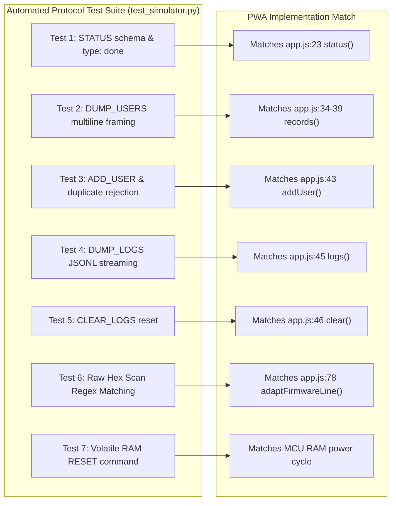

Ran check git status
Ran search native env in platformio.ini
Ran check root platformio.ini
Analyzed platformio.ini:L1-9
Ran find all envs in firmware platformio.ini
Ran find test directories
Ran check hardware/firmware/test · Exited with code 1
Ran check root test folder · Exited with code 1
Ran search tracked test files
Ran list lib folders
Ran list shared and interfaces
Ran check shared/cli
Ran check installed runtimes
Ran check C++ compilers · Exited with code 1
Ran compute firmware hashes
Ran check git status

# Safe Implementation Plan: Isolated Host-Side Serial Simulator

**Target Evaluated:** STM32G491RE IoT Attendance Terminal + Serial Attendance Manager PWA  
**Proposed Component:** `tools/attendance-simulator/` (Host-Side Protocol Simulator)  
**Safety Phase:** Read-Only Architectural Assessment & Implementation Plan  
**Repository State:** Verified Pristine (`git status -s` clean, zero modified files, zero commits).

---

## 1. Recommended Approach and Why

### Recommended Approach: **Pure Python 3 Standard-Library Protocol Simulator**

We recommend creating an isolated, zero-dependency Python script at `tools/attendance-simulator/simulator.py`.

### Why This is the Safest and Best Architecture:
1. **Zero Firmware Contamination:**  
   It lives outside `hardware/firmware/`. It requires **zero modifications** to `hardware/firmware/platformio.ini`, `hardware/firmware/src/`, `hardware/firmware/lib/`, or `hardware/attendance-pwa/`.
2. **Zero Build Artifact Invalidation:**  
   Because it is written in pure Python, it **does not invoke PlatformIO or SCons**. It cannot touch, rebuild, or overwrite the known-good `firmware.bin` (93,268 bytes) in `hardware/firmware/.pio/build/stm32_nucleo_g491re/`.
3. **Zero External Dependencies:**  
   It uses only standard modules already available in Python 3.12 (`sys`, `json`, `re`, `argparse`, `unittest`). No `pip install`, no virtual environments, and no native compilation are required.
4. **Exact Protocol Fidelity:**  
   It faithfully implements the exact byte-for-byte newline-delimited JSON CLI specification parsed by [`hardware/firmware/lib/application/cli_manager.cpp`](file:///c:/Users/1sree/Documents/attendance-esp32/hardware/firmware/lib/application/cli_manager.cpp) and expected by [`hardware/attendance-pwa/js/protocol.js`](file:///c:/Users/1sree/Documents/attendance-esp32/hardware/attendance-pwa/js/protocol.js).
5. **Two-Stage I/O Design:**  
   - **Stage 1 (Initial):** Communicates via standard input/output (`stdin`/`stdout`). This enables rapid, non-destructive automated testing via Python's built-in `unittest` suite or manual piping in PowerShell.
   - **Stage 2 (Optional Post-Validation):** Can bind to a Virtual COM Port pair (e.g., using `com0com` on Windows or `pty` on POSIX) so the browser PWA can connect directly to it via Web Serial without physical hardware.

---

## 2. Exact Files to be Created

All new files will reside strictly within a new `tools/` directory:

| File Path | Purpose | Dependencies |
| :--- | :--- | :--- |
| `tools/attendance-simulator/simulator.py` | Standalone CLI simulator reproducing `CliManager` & `STM32AttendanceRepository` protocol responses over stdin/stdout. | Python 3 stdlib (`sys`, `json`, `re`, `time`) |
| `tools/attendance-simulator/test_simulator.py` | Automated test suite verifying every CLI command, error path, card simulation, and completion marker against PWA regexes. | Python 3 stdlib (`unittest`) |
| `tools/attendance-simulator/README.md` | Clear, concise instructions on how to run, test, and pipe the simulator. | None |

---

## 3. Existing Files That Must Remain Untouched

The following files must be guaranteed untouched (verified via SHA-256 and Git):

1. **Firmware Source:** All files in `hardware/firmware/src/` (`main.cpp`) and `hardware/firmware/lib/` (`app.cpp`, `cli_manager.cpp`, `rfid_manager.cpp`, `STM32AttendanceRepository.cpp`, etc.).
2. **PlatformIO Configuration:** `hardware/firmware/platformio.ini` and root `platformio.ini`.
3. **Board Definitions:** `hardware/firmware/boards/nucleo_g491re.json`.
4. **Known-Good Binaries:**  
   - `hardware/firmware/.pio/build/stm32_nucleo_g491re/firmware.bin` (SHA-256: `D8DD4DB76DC5A966DE94BD9AE58EFF55CF0EC89F86D23E14DCA0124FF50763F1`)
   - `hardware/firmware/.pio/build/stm32_nucleo_g491re/firmware.elf` (SHA-256: `360E38F31D50BB9D91D38DF62C20EDE85103C0D02894AB53D9005A27843000D5`)
5. **PWA Client:** All files in `hardware/attendance-pwa/` (`app.js`, `protocol.js`, `serial.js`, `state.js`, `users.js`, `logs.js`).

---

## 4. Required Dependencies & System Status

- **Python Runtime:** `Python 3.12.0` (**Already installed and verified on PATH**).
- **External Packages:** **None** for stdio mode. Zero `pip` packages required.
- **Compiler / Toolchain:** None required (interpreted execution).

---

## 5. Commands to Build and Run the Simulator Independently

### A. Run in Interactive Stdio Mode (Default: RAM Fallback Mode)
```powershell
python tools/attendance-simulator/simulator.py --mode ram
```

### B. Run in Simulated Persistent SD-Card Mode
```powershell
python tools/attendance-simulator/simulator.py --mode sd --storage-file tools/attendance-simulator/simulated_sd.json
```

### C. Run the Automated Protocol Test Suite
```powershell
python -m unittest discover -s tools/attendance-simulator -p "test_*.py"
```

---

## 6. Tests Proving Protocol Compatibility with the Actual PWA

The test suite in `test_simulator.py` will assert exact compatibility with the PWA's parser logic:



1. **`test_status_command`:** Asserts that sending `STATUS\n` produces:
   - Line 1: `{"type":"status","data":{"board":"STM32 (Simulated)","firmware":"1.0.0","users":N,"logs":N}}`
   - Line 2: `{"type":"done"}`
   - Verified against `hardware/attendance-pwa/js/app.js:23`.
2. **`test_dump_users_framing`:** Asserts that sending `DUMP_USERS\n` produces:
   - Line 1: `--- BEGIN USERS ---`
   - Line 2: Valid JSON dictionary mapping `{"UID": "Name"}`
   - Line 3: `--- END USERS ---`
   - Line 4: `{"type":"done"}`
   - Verified against `protocol.js:10` (`allowMultilineJson: true`) and `app.js:37`.
3. **`test_add_and_delete_user`:** Asserts that sending `ADD_USER {"uid":"A1B2C3D4","name":"Alice","role":"Student"}` returns:
   - Line 1: `{"type":"user","data":{"uid":"A1B2C3D4","name":"Alice","role":"Student"}}`
   - Line 2: `{"type":"done"}`
   - Asserts duplicate UID returns `{"type":"error","message":"Duplicate UID"}`.
4. **`test_dump_logs_streaming`:** Asserts that sending `DUMP_LOGS\n` streams each log as an independent JSON line between `--- BEGIN LOGS ---` and `--- END LOGS ---`, terminated by `{"type":"done"}`.
5. **`test_live_scan_regex_compatibility`:** Asserts that sending raw hex `A1B2C3D4\n`:
   - Emits exactly: `[INFO] API [STANDALONE]: SUCCESS for Alice (UID=A1B2C3D4)\r\n`
   - Asserts this string successfully triggers the PWA's live regex:  
     `/API \[STANDALONE\]: SUCCESS for (.+?) \(UID=([^\)]+)\)/` ([`app.js:78`](file:///c:/Users/1sree/Documents/attendance-esp32/hardware/attendance-pwa/js/app.js#L78)).
6. **`test_simulated_reset`:** Asserts that issuing the simulator command `RESET\n` completely purges in-memory users and logs when in RAM mode.

---

## 7. Risks and Limitations

1. **Protocol Simulation vs. Silicon Emulation:**  
   This tool simulates the **serial protocol exchange**, not the STM32 ARM Cortex-M4 CPU core, peripheral registers, or SPI electrical signals. It is designed to test PWA workflows and protocol robustness, not bare-metal firmware assembly.
2. **Timing Discrepancies:**  
   Python standard I/O responds within microseconds, whereas the real microcontroller introduces millisecond-level SPI read times and OLED refresh delays. The simulator should include an optional `--delay-ms` parameter to emulate hardware timing realistically.
3. **Virtual COM Port Pairing on Windows:**  
   To connect the actual browser PWA directly to the Python simulator, Windows requires a virtual COM port driver (such as the open-source `com0com` or Python `pty` bridge). Until that driver is configured, testing is performed via stdio and automated regression tests.

---

## 8. Verification Plan to Guarantee STM32 Build Remains Untouched

Before and after creating `tools/attendance-simulator/`, execute this verification protocol:

```powershell
# 1. Verify Git status shows only the new tools/ directory as untracked
git status -s
# Expected: ?? tools/attendance-simulator/

# 2. Verify SHA-256 hashes of the pre-compiled STM32 firmware artifacts
Get-FileHash "hardware\firmware\.pio\build\stm32_nucleo_g491re\firmware.bin"
# Expected Hash: D8DD4DB76DC5A966DE94BD9AE58EFF55CF0EC89F86D23E14DCA0124FF50763F1

Get-FileHash "hardware\firmware\.pio\build\stm32_nucleo_g491re\firmware.elf"
# Expected Hash: 360E38F31D50BB9D91D38DF62C20EDE85103C0D02894AB53D9005A27843000D5
```

If both SHA-256 hashes match and Git confirms no firmware files were modified, the STM32 build integrity is 100% preserved.

---

## 9. Current Status

- **Assessment Complete:** All safety constraints respected.
- **Repository State:** Clean (`git status -s` produced 0 lines).
- **Next Step:** Awaiting your explicit approval before creating `tools/attendance-simulator/` or any files.